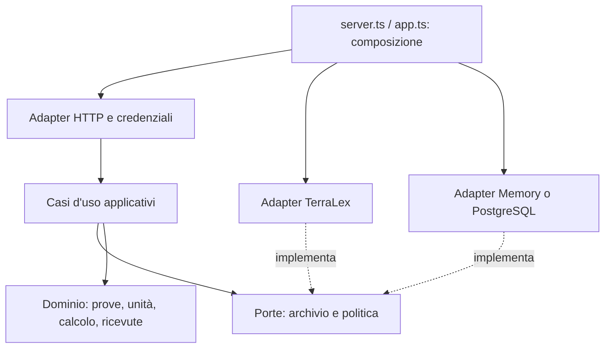

# Oracle: separazione dei livelli / Oracle layer separation

## Italiano

Questo refactor separa il processo ambientale da HTTP e dagli archivi. Conserva
il comportamento del prototipo; non aggiunge pipeline satellitari, runtime LLM,
previsioni o autorizzazioni alla spesa.

Prima `app.ts` conteneva rotte e processo di valutazione, mentre PostgreSQL
importava un validatore dal modulo che implementava anche Memory. Ora:

| Livello | Percorso sotto `services/oracle/src/` | Responsabilità |
| --- | --- | --- |
| Dominio | `domain/` | calcolo esistente, dati firmati, unità, ordinamento, integrità e ricevute; niente HTTP/DB/environment/rete |
| Applicazione | `application/` | casi d'uso, ordine delle operazioni, porte, orologio iniettato |
| Adapter | `adapters/` | HTTP/auth, TerraLex, Memory/PostgreSQL e arresto del processo |
| Composizione | `app.ts`, `server.ts` | collegare implementazioni e configurazione; avvio solo in server.ts |

`buildApp(AppOptions)` e tutti i percorsi storici restano compatibili tramite
riesportazione delle stesse classi/funzioni: niente copie incompatibili per
`instanceof`. I nomi `@terravoce/*`, versioni modello e hash restano invariati.
I nuovi subpath `@terravoce/oracle/application` e `/domain` permettono di usare i
livelli interni senza caricare HTTP o PostgreSQL. Nessun framework DI aggiunto.

L'autenticazione rimane nell'adapter HTTP prima di validazione e lookup. I casi
d'uso sono operazioni interne fidate, non endpoint autenticati; validano i comandi
anche per chiamanti non HTTP. Ordine conservato: selezione/verifica delle prove,
calcolo, salvataggio atomico assessment/ricevuta, politica e bozza reversibile.
Un errore della politica dopo il salvataggio non annulla una ricevuta già salvata.
Nessun retry, transazione distribuita o garanzia exactly-once aggiunti. Readiness
e chiusura ordinata mantengono deadline, sonda condivisa e drenaggio richieste.

### Confine per futuri agenti

`createEvidenceReader` crea un oggetto congelato con sole due operazioni:
catalogo e recupero ricevuta. Un `Pick` TypeScript lascerebbe i metodi di scrittura
sull'oggetto JavaScript originale. Questa capacità limita i verbi disponibili;
non sostituisce autenticazione, permessi territoriali, fiducia nelle chiavi o un
sandbox per codice ostile. Non consegnare a un agente l'aggregato OracleUseCases,
token Oracle/admin, credenziali di governance o chiavi della tesoreria.

Un futuro LLM può organizzare strumenti di lettura e spiegare dossier con fonti.
Il testo del modello non diventa misura, voto, policy o attestazione indipendente.
Questa è una possibilità architetturale, non una funzionalità LLM eseguita qui.

### Verifica e limiti

La fixture `services/oracle/test/fixtures/oracle-http-baseline.json` è stata
registrata prima del refactor, sulla produzione
`ad2595ffa24f47b72229b10b1bf5bfefdc949aa7`.
SHA256: `073df9d614bc872f2de32b45b1530e8e7b31b7a13316302173644a980188ae5e`.
Confronta 19 risposte deterministiche, firme, dati, hash, errori e header rilevanti.
CI la legge, senza rigenerarla. La chiave privata della fixture è deterministica
e pubblicamente ricostruibile: è vietato usarla per sensori reali.

I test diretti chiamano i casi d'uso senza Fastify/store concreto. Le regole AST
controllano import di tipo, riesportazioni, moduli dinamici, facade indirette e
accessi a environment/orologio implicito nell'application. Sono verifiche
circoscritte, non audit completo o prova di isolamento di JavaScript ostile.
I test esistenti e la CI con PostgreSQL e segnali Linux restano necessari.

Debito compatibile: DomainError.statusCode conserva i numeri HTTP storici.
La tassonomia pubblica degli errori non è stata ridisegnata. Protocollo,
TerraLex e Solidity restano componenti distinti. La ricerca su altri branch
non viene riscritta o promossa da questa patch. Nessuna validazione ambientale
o miglioramento di accuratezza discende dal riordino del software.

## English

The domain owns signed observations, existing analysis, units, ordering,
integrity and receipts. Application use cases depend on domain models and
application-owned storage/policy ports, with an explicit clock. Adapters implement
HTTP/authentication, TerraLex, Memory/PostgreSQL and shutdown. app.ts is the
compatible composition facade; server.ts retains configuration and startup.
PostgreSQL no longer imports Memory. No new runtime dependency is introduced.

Existing paths and buildApp remain compatible through re-exports of the same
class/function identities. New /application and /domain package subpaths expose
inner layers without HTTP/PostgreSQL. HTTP authenticates before command parsing
or storage; trusted internal use cases still validate command inputs.

Ordering remains select/verify, compute, atomically retain assessment/receipt,
evaluate policy, produce an allowed reversible draft. A policy failure after
retention does not roll back a saved packet. No retry or exactly-once guarantee
is introduced; readiness and graceful shutdown retain existing behavior.

createEvidenceReader constructs a separate frozen two-operation object; a
TypeScript-only Pick would leave privileged runtime methods available. This is
capability narrowing, not authentication, region scoping, external trust or a
hostile-code sandbox. Future agents must not receive the aggregate service,
writer/admin credentials or governance/treasury signers. No LLM API is called,
and model text is not measured evidence or an independent vote/attestation.

The pre-refactor fixture checks 19 HTTP responses plus exact signed packets and
hashes. Its source revision and SHA256 are above; CI reads rather than updates
it. Direct use-case tests need no HTTP or concrete store. AST rules check inward
dependencies, indirect facade paths and implicit application I/O/clock access.
Existing actual database/recovery/signal checks remain required. These bounded
software checks are not environmental validation.

DomainError.statusCode remains an explicit compatibility debt. Numerical models,
signed data, policy, governance, protected treasury and research branches remain
intact. The refactor adds no satellite pipeline, LLM runtime, forecast promotion
or spending authority. See the PR for checks executed on its exact revision.
